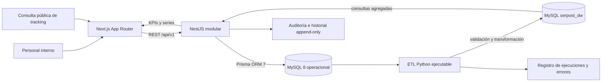

# Arquitectura de la plataforma

Propuesta inicial para la demostración académica de gestión logística y analítica. El PDF de referencia no se encontraba en el espacio de trabajo al redactar este documento; validar decisiones y modelo de datos contra el documento antes de cerrar la implementación.

## Componentes y flujo



El backend valida identidad, permisos, entradas y transiciones de estado. El navegador no accede directamente a la base de datos. El ETL opera sobre una conexión separada y no forma parte de las transacciones de envío.

## Estructura propuesta

```text
apps/
  web/                 Next.js, Bootstrap, componentes y funcionalidades
  api/                 NestJS, módulos de dominio y API REST
packages/
  shared/              Contratos y constantes compartidas sin lógica duplicada
analytics/
  etl/                 Extracción, validación y carga del DW
  models/              Modelos predictivos futuros
  tests/               Pruebas de transformaciones y métricas
database/              Documentación y SQL complementario
docs/                  Decisiones, arquitectura, diagramas y matriz RBAC
infra/                 Configuración local de infraestructura
```

## Límites entre dominios

- **Web:** presentación, accesibilidad, formularios, caché de consultas y visualización.
- **API:** autenticación, autorización, validación, reglas, transacciones, auditoría y contratos OpenAPI.
- **MySQL operacional:** estado actual y eventos de negocio transaccionales.
- **ETL/DW:** hechos y dimensiones derivados, carga repetible y consultas agregadas.
- **ML:** fase posterior y opcional; el sistema opera sin modelos entrenados.

## Seguridad base

- Cookies de sesión HttpOnly y protección CSRF para cambios de estado.
- Guards RBAC en NestJS y verificación de permisos en cada endpoint.
- Limitación de solicitudes para login y tracking público.
- DTOs validados, CORS restringido y secretos únicamente en variables de entorno.
- Auditoría sin contraseñas, tokens ni datos sensibles innecesarios.
- Respuestas de tracking público con una lista permitida de campos.
