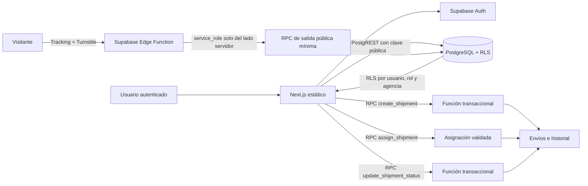

# Arquitectura de la primera entrega

La aplicación mantiene una exportación estática de Next.js para GitHub Pages. No depende de handlers, Server Actions ni middleware. El proyecto referencia `docs/referencia.pdf` para validar el modelo final; no se encontró ese documento en el espacio de trabajo.

## Componentes y flujo

## Persistencia implementada

La migración `supabase/migrations/20261025230000_initial_logistics.sql` crea:

- `roles`, con los siete perfiles admitidos.
- `agencies`.
- `profiles`, asociado a `auth.users`; el trigger de alta crea perfiles `client` y no lee roles de metadata.
- `customers`, creado junto con el perfil cliente.
- `shipments`, con tracking criptográficamente aleatorio de 128 bits, único e inmutable.
- `shipment_assignments`, con empleado, rol operativo, envío y agencia validados.
- `shipment_history`, escrito por trigger en la misma transacción que la creación/cambio de estado y con actor `auth.uid()`.

Las escrituras directas desde `anon` y `authenticated` están revocadas. Las mutaciones de cliente usan RPC con rol, activación, agencia y asignación validados; el flujo de estado no puede confirmar sin insertar historial. Los perfiles inactivos no operan ni leen envíos.

El tracking público usa una ruta estática `/tracking/`, Turnstile en cliente y una Edge Function independiente de Next.js. La función verifica el desafío en servidor y usa un RPC no ejecutable por `anon` ni `authenticated`; solo retorna estado, agencia/ciudad, fechas y una descripción explícitamente pública. No concede lectura anónima de `shipments` ni `shipment_history`.

## Límites de la primera entrega

- **Autenticación:** Supabase Auth con correo/contraseña, confirmación de correo, restablecimiento y cierre de sesión. El cliente de Supabase persiste la sesión en el navegador.
- **Autorización y reglas:** RLS y funciones SQL con `SECURITY DEFINER`, `search_path` vacío, permisos `EXECUTE` acotados, activación, identidad, agencia y asignación; cambios de estado e historial atómicos.
- **Web:** presentación estática, carga de perfil protegido y formularios. El rol mostrado es el leído desde PostgreSQL; ocultar una pantalla no otorga permisos.
- **Analítica y logística ampliada:** bandejas, reglas de clasificación, despachos, rutas, flota, incidencias, evidencias, reportes y ETL/ML quedan fuera de esta entrega. El alcance por perfil está en `docs/matriz-permisos.md`.

El frontend contiene únicamente valores públicos (`anon`/`publishable` y Turnstile site key). La clave `service_role` se usa solo como secreto preconfigurado del runtime de Supabase Functions; no hay clave administrativa en el código ni en la compilación de Pages.
