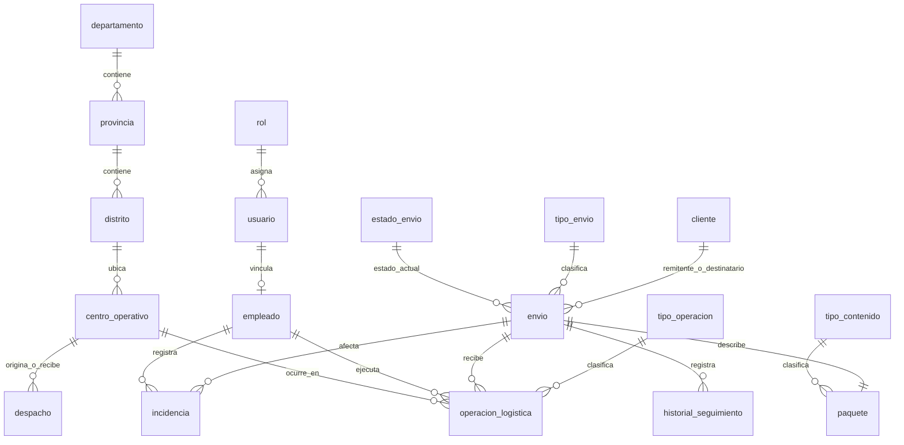
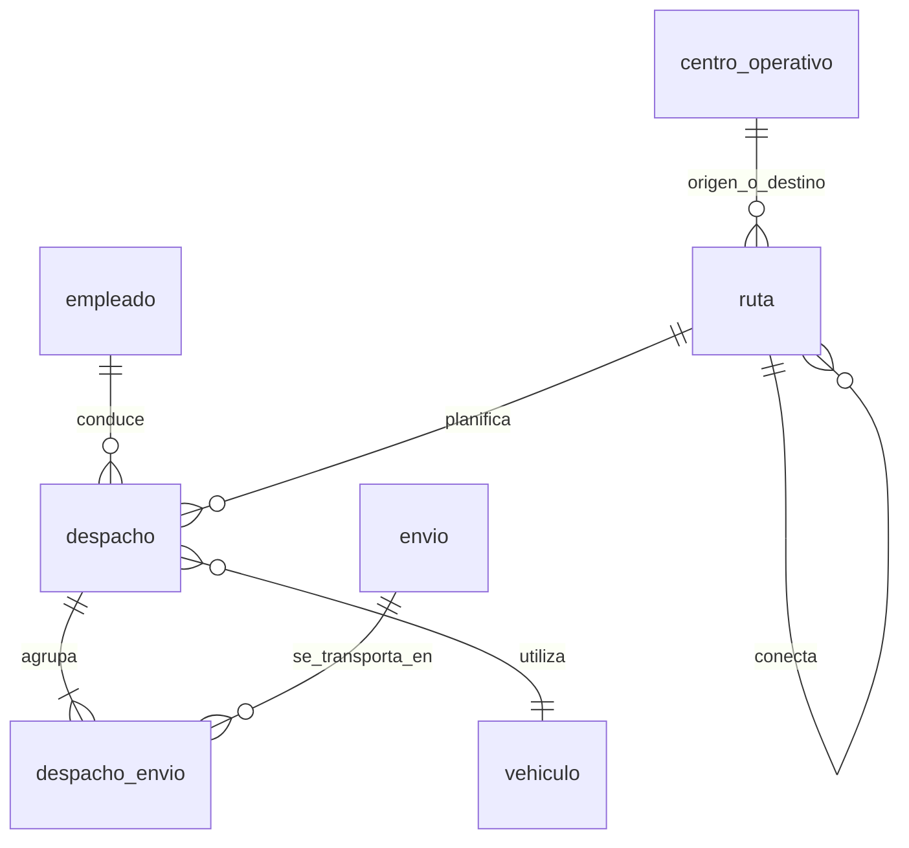

# Modelo entidad-relación conceptual

Este diagrama es una propuesta de análisis basada en la lista entregada por el usuario. No representa un esquema comprobado del PDF ni debe usarse como migración física definitiva antes de revisar `docs/referencia.pdf`.

## Entidades enumeradas en el requerimiento

La lista entregada nombra 18 entidades: `rol`, `usuario`, `empleado`, `departamento`, `provincia`, `distrito`, `centro_operativo`, `cliente`, `envio`, `paquete`, `tipo_envio`, `tipo_contenido`, `estado_envio`, `tipo_operacion`, `operacion_logistica`, `historial_seguimiento`, `despacho` e `incidencia`. Las cardinalidades anteriores son hipótesis para discutir, no inferencias confirmadas del documento.

## Entidades complementarias propuestas

- `vehiculo`: capacidad de peso/volumen y asignación a un traslado.
- `ruta`: trayecto planeado y centros de origen/destino.
- `despacho_envio`: asociación que permite agrupar varios envíos y conservar su relación con despachos.

La forma de representar origen y destino, rutas con varios tramos, asignaciones de empleados y estados de despacho requiere contraste con los procesos del PDF.

## Reglas de integridad propuestas

- Tracking único e inmutable.
- Eventos de seguimiento insert-only; rectificaciones como nuevos eventos relacionados.
- Transiciones de estado validadas en una operación transaccional.
- Capacidad de vehículo validada antes de confirmar la asignación del despacho.
- Granularidad de `Fact_Envios`: una fila por envío; agregar por separado operaciones e incidencias antes de integrarlas a métricas para evitar multiplicaciones.
